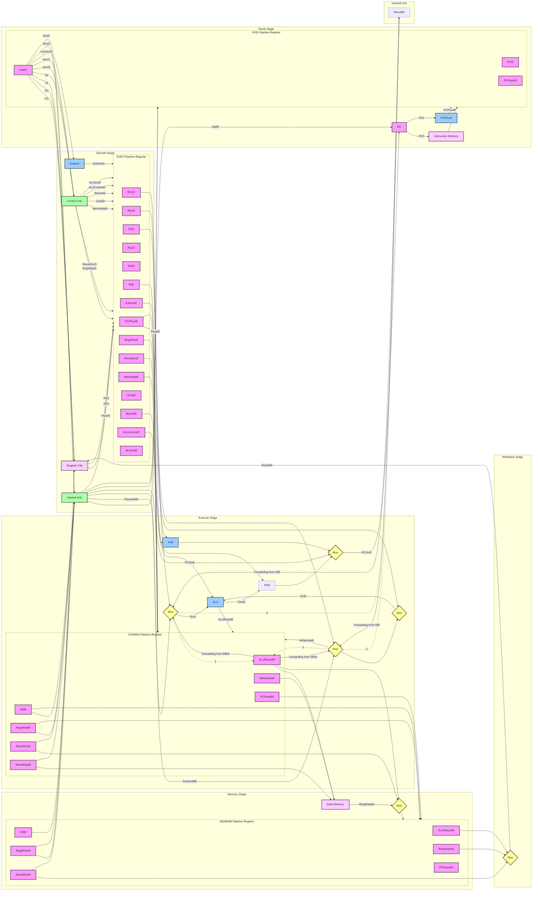

# RISC-V RV32I 5-Stage Pipelined Processor (Verilog)

## Table of Contents

1. [Project Title and Overview](#project-title-and-overview)
2. [Project Objectives and Design Goals](#project-objectives-and-design-goals)
3. [Processor Architecture and ISA](#processor-architecture-and-isa)
4. [Architecture Block Diagram](#architecture-block-diagram)
5. [Datapath and Pipeline Explanation](#datapath-and-pipeline-explanation)
6. [Module-by-Module Documentation](#module-by-module-documentation)
7. [Instruction Set and Formats](#instruction-set-and-formats)
8. [Control Unit, ALU, Register File, PC, Immediate Generation, Branch Logic, Memory Interface, Forwarding, and Hazard Handling](#control-unit-alu-register-file-pc-immediate-generation-branch-logic-memory-interface-forwarding-and-hazard-handling)
9. [Repository Directory Tree](#repository-directory-tree)
10. [Testbench Documentation](#testbench-documentation)
11. [Verification Strategy and Limitations](#verification-strategy-and-limitations)
12. [XDC Constraints Explanation](#xdc-constraints-explanation)
13. [Required Tools and Dependencies](#required-tools-and-dependencies)
14. [Compilation, Simulation, Synthesis, and Programming Instructions](#compilation-simulation-synthesis-and-programming-instructions)
15. [Expected Simulation Outputs and Waveform Inspection](#expected-simulation-outputs-and-waveform-inspection)
16. [Design Limitations, Known Issues, and Future Improvements](#design-limitations-known-issues-and-future-improvements)
17. [Performance Metrics](#performance-metrics)
18. [Project Status, Contribution, Licensing, and Acknowledgments](#project-status-contribution-licensing-and-acknowledgments)
19. [Conclusion](#conclusion)

---

## Project Title and Overview

This repository contains a Verilog implementation of a 32-bit RISC-V pipelined processor. Based on the supplied source files, the design implements a five-stage pipeline with separate instruction and data memories, a 32-entry register file, forwarding, load-use stalling, and branch/jump flushing.

The top-level module is `Pipeline_top` in `Pipeline_Top.v`. It integrates the fetch, decode, execute, memory, and writeback stages, plus a hazard unit. The design targets a subset of the RV32I base integer instruction set. A directed SystemVerilog testbench, `tb_pipeline.sv`, exercises the processor and checks register values through hierarchical access.

An XDC constraints file, named `## Pipeline_Top.xdc.txt`, targets the Digilent Basys3 board (`xc7a35tcpg236-1`) and maps `clk`, `rst_n`, and `Result_Debug[15:0]` to board pins. The constraints file comments indicate a Vivado 2020.x+ flow.

> **Important:** The instruction memory uses `$readmemh("memfile.mem", mem);`. The file `memfile.mem` is **not included** in the supplied files. The testbench expectations depend on a specific program image in that file.

---

## Project Objectives and Design Goals

From the source code, the design goals appear to be:

- Implement a classic five-stage RISC-V pipeline: Fetch, Decode, Execute, Memory, Writeback.
- Support a practical subset of RV32I integer instructions.
- Resolve data hazards using EX/MEM and MEM/WB forwarding.
- Detect load-use hazards and insert a one-cycle stall.
- Resolve branches and jumps in the Execute stage and flush incorrect-path instructions.
- Provide synthesizable RTL for FPGA prototyping on a Basys3 board.
- Provide a directed simulation testbench for functional verification.

The design does **not** implement caches, exceptions, interrupts, CSRs, virtual memory, or advanced branch prediction.

---

## Processor Architecture and ISA

### Verified Architecture

| Feature | Implementation |
|---|---|
| ISA | RV32I subset |
| Data width | 32 bits |
| Address width | 32 bits |
| Pipeline depth | 5 stages |
| Register file | 32 × 32-bit, x0 hardwired to zero |
| Instruction memory | 1024 × 32-bit words, word-addressed via `A[11:2]` |
| Data memory | 1024 × 32-bit words, word-addressed via `A[11:2]` |
| Reset | Active-low `rst_n` |
| Pipeline registers | IF/ID, ID/EX, EX/MEM, MEM/WB |
| Hazard handling | Forwarding, load-use stall, branch/jump flush |
| Branch resolution | Execute stage |
| Clock constraint | 10 ns in XDC, i.e. 100 MHz requested constraint |

### Verified ISA Support

The control decoder supports these opcodes:

- R-type: `0110011`
- I-type ALU: `0010011`
- LW: `0000011`
- SW: `0100011`
- Branch: `1100011`
- JAL: `1101111`
- JALR: `1100111`
- LUI: `0110111`
- AUIPC: `0010111`

The ALU decoder and execute stage support the corresponding ALU operations for these instructions. The processor does **not** decode or implement byte/halfword loads/stores, CSR instructions, system instructions, FENCE, ECALL, EBREAK, or privileged modes.

---

## Architecture Block Diagram



---

## Datapath and Pipeline Explanation

The processor uses a standard five-stage pipeline.

### 1. Fetch (IF)

Implemented in `fetch_cycle` (`Fetch_Cycle.v`).

- `PC_MUX` selects between `PCPlus4F` and `PCTargetE` using `PCSrcE`.
- `PC_Module` updates the program counter on the rising clock edge.
- `Instruction_Memory` reads the instruction word using `PCF[11:2]`.
- `PC_Adder` computes `PCF + 4`.
- The IF/ID pipeline registers capture `InstrF_r`, `PCF_r`, and `PCPlus4F_r`.
- `StallF` holds the IF/ID register.
- `FlushD` inserts a NOP (`32'h0000_0013`) into `InstrF_r` while still updating `PCF_r` and `PCPlus4F_r`.

### 2. Decode (ID)

Implemented in `decode_cycle` (`Decode_Cycle.v`).

- `Control_Unit_Top` decodes the instruction and generates control signals.
- `Register_File` reads `rs1` and `rs2`.
- `Sign_Extend` generates the immediate value according to `ImmSrcD`.
- The ID/EX pipeline registers capture control signals, register values, immediate, `PCE`, and `PCPlus4E`.
- `FlushE` zeroes the ID/EX control and data registers, inserting a bubble.
- `UsesRs1D` and `UsesRs2D` are combinational and used by the hazard unit for load-use detection.

### 3. Execute (EX)

Implemented in `execute_cycle` (`Execute_Cycle.v`).

- Two `Mux_3_by_1` blocks implement forwarding for `Src_A` and `Src_B`.
- `AUIPCE` selects `PCE` as `Src_A` for AUIPC.
- `ALUSrcE` selects the immediate as `Src_B` for I-type, LW, SW, JALR, and AUIPC.
- The `ALU` performs the operation selected by `ALUControlE`.
- The branch comparator computes `brEq`, `brLt`, and `brLtU` from forwarded operands.
- `PCSrcE = JumpE | (BranchE & branch_taken)`.
- `PCTargetE` is either `PCE + Imm_Ext_E` or the JALR target `(Src_A_fwd + Imm_Ext_E) & 32'hFFFF_FFFE`.
- The EX/MEM pipeline registers capture `RegWriteE`, `MemWriteE`, `ResultSrcE`, `RD_E`, `PCPlus4E`, store data, ALU result, and immediate.

### 4. Memory (MEM)

Implemented in `memory_cycle` (`Memory_Cycle.v`).

- `Data_Memory` performs word-addressed load/store using `ALU_ResultM[11:2]`.
- Store data is `WriteDataM`, which is the forwarded `rs2` value.
- The MEM/WB pipeline registers capture `RegWriteM`, `ResultSrcM`, `RD_M`, `PCPlus4M`, `ALU_ResultM`, `ReadDataM`, and `Imm_ExtM`.

### 5. Writeback (WB)

Implemented in `writeback_cycle` (`Writeback_Cycle.v`).

- `Mux_4_by_1` selects `ResultW` according to `ResultSrcW`:
  - `00`: `ALU_ResultW`
  - `01`: `ReadDataW`
  - `10`: `PCPlus4W`
  - `11`: `Imm_ExtW`
- `ResultW` is written back to the register file through `Register_File`.

---

## Module-by-Module Documentation

### Top-Level Integration

| Module | File | Role |
|---|---|---|
| `Pipeline_top` | `Pipeline_Top.v` | Top-level integration of all pipeline stages and hazard unit |

`Pipeline_top` ports:

| Direction | Signal | Width | Description |
|---|---|---|---|
| Input | `clk` | 1 | System clock |
| Input | `rst_n` | 1 | Active-low reset |
| Output | `Result_Debug` | 16 | Lower 16 bits of `ResultW` |
| Output | `Instr_Debug` | 32 | Instruction in Decode stage |
| Output | `PC_Debug` | 32 | PC in Decode stage |
| Output | `RegWrite_Debug` | 1 | Writeback register write enable |

Internally it instantiates:

- `fetch_cycle Fetch`
- `decode_cycle Decode`
- `execute_cycle Execute`
- `memory_cycle Memory`
- `writeback_cycle WriteBack`
- `hazard_unit Hazard`

### Fetch Stage

| Module | File | Role |
|---|---|---|
| `fetch_cycle` | `Fetch_Cycle.v` | IF stage, PC, instruction memory, IF/ID registers |
| `PC_Module` | `PC.v` | Program counter register |
| `Instruction_Memory` | `Instruction_Memory.v` | 1024 × 32-bit instruction memory |
| `PC_Adder` | `PC_Adder.v` | PC + 4 adder |
| `Mux` | `Mux.v` | PC source mux |

`fetch_cycle` ports:

| Direction | Signal | Width | Description |
|---|---|---|---|
| Input | `clk` | 1 | Clock |
| Input | `rst_n` | 1 | Active-low reset |
| Input | `StallF` | 1 | Stall fetch |
| Input | `FlushD` | 1 | Flush Decode input |
| Input | `PCSrcE` | 1 | PC select from Execute |
| Input | `PCTargetE` | 32 | Branch/jump target from Execute |
| Output | `InstrD` | 32 | Instruction to Decode |
| Output | `PCD` | 32 | PC to Decode |
| Output | `PCPlus4D` | 32 | PC+4 to Decode |

### Decode Stage

| Module | File | Role |
|---|---|---|
| `decode_cycle` | `Decode_Cycle.v` | ID stage, control, register file, immediate generation, ID/EX registers |
| `Control_Unit_Top` | `Control_Unit_Top.v` | Control wrapper |
| `Main_Decoder` | `Main_Decoder.v` | Main control decoder |
| `ALU_Decoder` | `ALU_Decoder.v` | ALU control decoder |
| `Register_File` | `Register_File.v` | 32 × 32-bit register file |
| `Sign_Extend` | `Sign_Extend.v` | Immediate generator |

`decode_cycle` ports:

| Direction | Signal | Width | Description |
|---|---|---|---|
| Input | `RegWriteW` | 1 | Writeback enable |
| Input | `clk` | 1 | Clock |
| Input | `rst_n` | 1 | Active-low reset |
| Input | `FlushE` | 1 | Flush Execute register |
| Input | `InstrD` | 32 | Instruction from Fetch |
| Input | `PCD` | 32 | PC from Fetch |
| Input | `PCPlus4D` | 32 | PC+4 from Fetch |
| Input | `ResultW` | 32 | Writeback result |
| Input | `RDW` | 5 | Writeback destination register |
| Output | `UsesRs1D` | 1 | Instruction uses rs1 |
| Output | `UsesRs2D` | 1 | Instruction uses rs2 |
| Output | `RegWriteE` | 1 | Register write enable to Execute |
| Output | `ALUSrcE` | 1 | ALU source select to Execute |
| Output | `MemWriteE` | 1 | Memory write enable to Execute |
| Output | `BranchE` | 1 | Branch enable to Execute |
| Output | `JumpE` | 1 | Jump enable to Execute |
| Output | `JalrE` | 1 | JALR enable to Execute |
| Output | `AUIPCE` | 1 | AUIPC enable to Execute |
| Output | `ResultSrcE` | 2 | Result source to Execute |
| Output | `ALUControlE` | 4 | ALU control to Execute |
| Output | `funct3E` | 3 | funct3 to Execute |
| Output | `RD1_E` | 32 | rs1 value to Execute |
| Output | `RD2_E` | 32 | rs2 value to Execute |
| Output | `Imm_Ext_E` | 32 | Immediate to Execute |
| Output | `RS1_E` | 5 | rs1 address to Execute |
| Output | `RS2_E` | 5 | rs2 address to Execute |
| Output | `RD_E` | 5 | Destination address to Execute |
| Output | `PCE` | 32 | PC to Execute |
| Output | `PCPlus4E` | 32 | PC+4 to Execute |

### Execute Stage

| Module | File | Role |
|---|---|---|
| `execute_cycle` | `Execute_Cycle.v` | EX stage, forwarding, ALU, branch comparator, EX/MEM registers |
| `ALU` | `ALU.v` | 32-bit ALU |
| `Mux_3_by_1` | `Mux.v` | Forwarding muxes |
| `Mux` | `Mux.v` | AUIPC and ALUSrc muxes |

`execute_cycle` ports:

| Direction | Signal | Width | Description |
|---|---|---|---|
| Input | `clk` | 1 | Clock |
| Input | `rst_n` | 1 | Active-low reset |
| Input | `RegWriteE` | 1 | Register write enable |
| Input | `ALUSrcE` | 1 | ALU source select |
| Input | `MemWriteE` | 1 | Memory write enable |
| Input | `BranchE` | 1 | Branch enable |
| Input | `JumpE` | 1 | Jump enable |
| Input | `JalrE` | 1 | JALR enable |
| Input | `AUIPCE` | 1 | AUIPC enable |
| Input | `ResultSrcE` | 2 | Result source |
| Input | `ForwardA_E` | 2 | Forward select for A |
| Input | `ForwardB_E` | 2 | Forward select for B |
| Input | `ALUControlE` | 4 | ALU control |
| Input | `funct3E` | 3 | Branch funct3 |
| Input | `RD_E` | 5 | Destination register |
| Input | `PCE` | 32 | PC |
| Input | `PCPlus4E` | 32 | PC+4 |
| Input | `ResultW` | 32 | Writeback result |
| Input | `RD1_E` | 32 | rs1 value |
| Input | `RD2_E` | 32 | rs2 value |
| Input | `Imm_Ext_E` | 32 | Immediate |
| Output | `PCSrcE` | 1 | PC source select |
| Output | `RegWriteM` | 1 | Register write enable to MEM |
| Output | `MemWriteM` | 1 | Memory write enable to MEM |
| Output | `ResultSrcM` | 2 | Result source to MEM |
| Output | `RD_M` | 5 | Destination to MEM |
| Output | `PCPlus4M` | 32 | PC+4 to MEM |
| Output | `WriteDataM` | 32 | Store data to MEM |
| Output | `ALU_ResultM` | 32 | ALU result to MEM |
| Output | `PCTargetE` | 32 | Branch/jump target to Fetch |
| Output | `Imm_ExtM` | 32 | Immediate to MEM |

### Memory Stage

| Module | File | Role |
|---|---|---|
| `memory_cycle` | `Memory_Cycle.v` | MEM stage, data memory, MEM/WB registers |
| `Data_Memory` | `Data_Memory.v` | 1024 × 32-bit data memory |

`memory_cycle` ports:

| Direction | Signal | Width | Description |
|---|---|---|---|
| Input | `clk` | 1 | Clock |
| Input | `rst_n` | 1 | Active-low reset |
| Input | `RegWriteM` | 1 | Register write enable |
| Input | `MemWriteM` | 1 | Memory write enable |
| Input | `ResultSrcM` | 2 | Result source |
| Input | `RD_M` | 5 | Destination register |
| Input | `PCPlus4M` | 32 | PC+4 |
| Input | `WriteDataM` | 32 | Store data |
| Input | `ALU_ResultM` | 32 | ALU result / address |
| Input | `Imm_ExtM` | 32 | Immediate |
| Output | `RegWriteW` | 1 | Register write enable to WB |
| Output | `ResultSrcW` | 2 | Result source to WB |
| Output | `RD_W` | 5 | Destination to WB |
| Output | `PCPlus4W` | 32 | PC+4 to WB |
| Output | `ALU_ResultW` | 32 | ALU result to WB |
| Output | `ReadDataW` | 32 | Load data to WB |
| Output | `Imm_ExtW` | 32 | Immediate to WB |

### Writeback Stage

| Module | File | Role |
|---|---|---|
| `writeback_cycle` | `Writeback_Cycle.v` | WB stage result mux |
| `Mux_4_by_1` | `Mux.v` | Result source mux |

`writeback_cycle` ports:

| Direction | Signal | Width | Description |
|---|---|---|---|
| Input | `clk` | 1 | Clock, unused in current implementation |
| Input | `rst_n` | 1 | Active-low reset, unused in current implementation |
| Input | `ResultSrcW` | 2 | Result source select |
| Input | `PCPlus4W` | 32 | PC+4 |
| Input | `ALU_ResultW` | 32 | ALU result |
| Input | `ReadDataW` | 32 | Load data |
| Input | `Imm_ExtW` | 32 | Immediate |
| Output | `ResultW` | 32 | Writeback result |

### Hazard Unit

| Module | File | Role |
|---|---|---|
| `hazard_unit` | `Hazard_unit.v` | Forwarding, load-use stall, flush generation |

`hazard_unit` ports:

| Direction | Signal | Width | Description |
|---|---|---|---|
| Input | `rst_n` | 1 | Active-low reset |
| Input | `RegWriteM` | 1 | MEM stage register write |
| Input | `RegWriteW` | 1 | WB stage register write |
| Input | `RD_M` | 5 | MEM destination |
| Input | `RD_W` | 5 | WB destination |
| Input | `Rs1_E` | 5 | EX rs1 |
| Input | `Rs2_E` | 5 | EX rs2 |
| Input | `Rs1_D` | 5 | Decode rs1 |
| Input | `Rs2_D` | 5 | Decode rs2 |
| Input | `RD_E` | 5 | EX destination |
| Input | `UsesRs1D` | 1 | Decode uses rs1 |
| Input | `UsesRs2D` | 1 | Decode uses rs2 |
| Input | `ResultSrcE_load` | 1 | EX instruction is a load |
| Input | `PCSrcE` | 1 | Branch/jump taken |
| Output | `ForwardAE` | 2 | Forward select A |
| Output | `ForwardBE` | 2 | Forward select B |
| Output | `StallF` | 1 | Stall Fetch |
| Output | `StallD` | 1 | Stall Decode, generated but not used in `Pipeline_top` |
| Output | `FlushD` | 1 | Flush Decode |
| Output | `FlushE` | 1 | Flush Execute |

### Muxes

`Mux.v` contains:

- `Mux`: 2:1, 32-bit mux.
- `Mux_3_by_1`: 3:1, 32-bit mux.
- `Mux_4_by_1`: 4:1, 32-bit mux.

These are used for PC selection, forwarding, AUIPC, ALUSrc, and writeback result selection.

---

## Instruction Set and Formats

The implementation supports these RV32I instructions:

| Format | Instructions | Notes |
|---|---|---|
| R-type | `ADD`, `SUB`, `AND`, `OR`, `XOR`, `SLT`, `SLTU`, `SLL`, `SRL`, `SRA` | Decoded by `ALU_Decoder` using `funct3` and `funct7[5]` |
| I-type ALU | `ADDI`, `SLTI`, `SLTIU`, `XORI`, `ORI`, `ANDI`, `SLLI`, `SRLI`, `SRAI` | `funct7[5]` distinguishes `SRLI`/`SRAI` |
| Load | `LW` | Only word loads; other load funct3 values are not separately decoded |
| Store | `SW` | Only word stores; other store funct3 values are not separately decoded |
| Branch | `BEQ`, `BNE`, `BLT`, `BGE`, `BLTU`, `BGEU` | Branch comparison in Execute stage |
| Jump | `JAL`, `JALR` | JALR clears bit 0 of target |
| Upper immediate | `LUI`, `AUIPC` | AUIPC uses PC + immediate |

Unsupported instructions include `LB`, `LH`, `LBU`, `LHU`, `SB`, `SH`, CSR instructions, `ECALL`, `EBREAK`, `FENCE`, and all privileged instructions.

### Immediate Formats

`Sign_Extend` supports:

| `ImmSrc` | Format | Description |
|---|---|---|
| `3'b000` | I-type | `{{20{In[31]}}, In[31:20]}` |
| `3'b001` | S-type | `{{20{In[31]}}, In[31:25], In[11:7]}` |
| `3'b010` | B-type | `{{19{In[31]}}, In[31], In[7], In[30:25], In[11:8], 1'b0}` |
| `3'b011` | J-type | `{{11{In[31]}}, In[31], In[19:12], In[20], In[30:21], 1'b0}` |
| `3'b100` | U-type | `{In[31:12], 12'b0}` |

---

## Control Unit, ALU, Register File, PC, Immediate Generation, Branch Logic, Memory Interface, Forwarding, and Hazard Handling

### Control Unit

`Control_Unit_Top` instantiates `Main_Decoder` and `ALU_Decoder`.

`Main_Decoder` outputs:

- `RegWrite`
- `ALUSrc`
- `MemWrite`
- `Branch`
- `Jump`
- `Jalr`
- `AUIPC`
- `UsesRs1`
- `UsesRs2`
- `ImmSrc[2:0]`
- `ResultSrc[1:0]`
- `ALUOp[1:0]`

Opcode decoding:

| Opcode | Instruction type | Key control settings |
|---|---|---|
| `0110011` | R-type | `RegWrite=1`, `UsesRs1=1`, `UsesRs2=1`, `ResultSrc=00`, `ALUOp=10` |
| `0010011` | I-type ALU | `RegWrite=1`, `ALUSrc=1`, `UsesRs1=1`, `ImmSrc=000`, `ResultSrc=00`, `ALUOp=10` |
| `0000011` | LW | `RegWrite=1`, `ALUSrc=1`, `UsesRs1=1`, `ImmSrc=000`, `ResultSrc=01`, `ALUOp=00` |
| `0100011` | SW | `ALUSrc=1`, `MemWrite=1`, `UsesRs1=1`, `UsesRs2=1`, `ImmSrc=001`, `ALUOp=00` |
| `1100011` | Branch | `Branch=1`, `UsesRs1=1`, `UsesRs2=1`, `ImmSrc=010`, `ALUOp=01` |
| `1101111` | JAL | `RegWrite=1`, `Jump=1`, `ImmSrc=011`, `ResultSrc=10` |
| `1100111` | JALR | `RegWrite=1`, `ALUSrc=1`, `Jump=1`, `Jalr=1`, `UsesRs1=1`, `ImmSrc=000`, `ResultSrc=10` |
| `0110111` | LUI | `RegWrite=1`, `ImmSrc=100`, `ResultSrc=11` |
| `0010111` | AUIPC | `RegWrite=1`, `AUIPC=1`, `ALUSrc=1`, `ImmSrc=100`, `ResultSrc=00` |

`ALU_Decoder` maps `ALUOp`, `funct3`, `funct7`, and `op` to `ALUControl[3:0]`.

### ALU

`ALU.v` implements:

| `ALUControl` | Operation |
|---|---|
| `0000` | ADD |
| `0001` | SUB |
| `0010` | AND |
| `0011` | OR |
| `0100` | XOR |
| `0101` | SLT signed |
| `0110` | SLTU unsigned |
| `0111` | SLL |
| `1000` | SRL |
| `1001` | SRA |

Outputs `Result`, `Zero`, and `Negative`. `Zero` and `Negative` are connected in `execute_cycle` but not used by the branch comparator, which computes its own comparison.

### Register File

`Register_File.v` implements a 32 × 32-bit register file.

- Asynchronous reads.
- Synchronous write on `posedge clk`.
- Write disabled when `A3 == 5'h00`.
- Reads from `x0` return `32'h0`.
- Initialized to zero through an `initial` block.
- No reset input.

### Program Counter

`PC_Module` in `PC.v`:

- Active-low asynchronous reset.
- Resets `PC` to `32'h0000_0000`.
- Otherwise updates `PC <= PC_Next` on `posedge clk`.

`PC_Adder` computes `PC + 4`.

### Immediate Generation

`Sign_Extend.v` generates I, S, B, J, and U immediates as described above.

### Branch Logic

Branch comparison is in `execute_cycle`:

- `br_diff = Src_A_fwd - Src_B_fwd`
- `brEq = (br_diff == 0)`
- `brLt` for signed comparison.
- `brLtU` for unsigned comparison.
- `branch_taken` selected by `funct3E`.

Branch encodings:

| `funct3E` | Branch | Taken condition |
|---|---|---|
| `000` | BEQ | `brEq` |
| `001` | BNE | `~brEq` |
| `100` | BLT | `brLt` |
| `101` | BGE | `~brLt` |
| `110` | BLTU | `brLtU` |
| `111` | BGEU | `~brLtU` |

`PCSrcE = JumpE | (BranchE & branch_taken)`.

### Memory Interface

- Instruction memory: 1024 × 32-bit, word-addressed by `A[11:2]`.
- Data memory: 1024 × 32-bit, word-addressed by `A[11:2]`.
- Instruction memory initializes all words to NOP (`32'h00000013`) and loads `memfile.mem`.
- Data memory initializes all words to zero.
- No byte enables; only 32-bit word accesses are supported.

### Forwarding

The hazard unit generates `ForwardAE` and `ForwardBE`:

| Select | Source |
|---|---|
| `00` | Original register value from Decode |
| `01` | Writeback result `ResultW` |
| `10` | Memory-stage ALU result `ALU_ResultM` |

Priority is given to the MEM stage over WB stage.

### Hazard Handling

- Load-use hazard:
  - `lwStall = ResultSrcE_load && (RD_E != 0) && ((UsesRs1D && Rs1_D == RD_E) || (UsesRs2D && Rs2_D == RD_E))`
  - `StallF = lwStall`
  - `StallD = lwStall` (generated but not used in `Pipeline_top`)
  - `FlushE = lwStall | PCSrcE`
- Control hazard:
  - `FlushD = PCSrcE`
  - `FlushE = lwStall | PCSrcE`

Branches and jumps are resolved in Execute, causing incorrect-path instructions in Decode and Execute to be flushed.
---
## Testbench Documentation

### Testbench File

`tb_pipeline.sv`

### DUT

```systemverilog
Pipeline_top uut (.clk(clk), .rst_n(rst_n));
```

### Clock and Reset

- Clock toggles every 5 ns, giving a 10 ns period (100 MHz simulation clock).
- `rst_n` is held low for 4 clock cycles, then released.
- The testbench waits 400 clock cycles before checking results.
- A watchdog triggers `$fatal` after 5000 cycles.

### Checking Task

```systemverilog
task chk(input int idx, input [31:0] exp, input string nm);
```

It compares `uut.Decode.rf.Register[idx]` against `exp` and prints `[PASS]` or `[FAIL]`.

### Directed Checks

| Register | Expected value | Label |
|---|---|---|
| x1 | `32'd5` | ADDI |
| x2 | `32'd3` | ADDI |
| x3 | `32'd8` | ADD |
| x4 | `32'd2` | SUB |
| x5 | `32'd1` | AND |
| x6 | `32'd7` | OR |
| x7 | `32'd6` | XOR |
| x8 | `32'd8` | LW |
| x10 | `32'd42` | BEQ-skip |
| x11 | `32'h00000034` | JAL link |
| x13 | `32'd1` | post-JAL |
| x14 | `32'hDEADB000` | LUI |
| x15 | `32'h00000048` | AUIPC |

The testbench prints a summary line:

```text
PASS=<n> FAIL=<n>
```

If `fail_cnt == 0`, it calls `$finish(0)`; otherwise it calls `$fatal(1, "FAIL")`.


## Project Status, Contribution, Licensing, and Acknowledgments

### Project Status

- RTL source files for a five-stage RV32I subset are present.
- A directed SystemVerilog testbench is present.
- An XDC and SDC file for Basys3 is present.
- `memfile.mem` is Included.

### Contribution Guidelines

Not specified in the supplied files. A typical contribution process would include:

1. Fork the repository.
2. Create a feature branch.
3. Add tests for new behavior.
4. Ensure existing tests still pass.
5. Submit a pull request with a clear description.

## Conclusion
---
